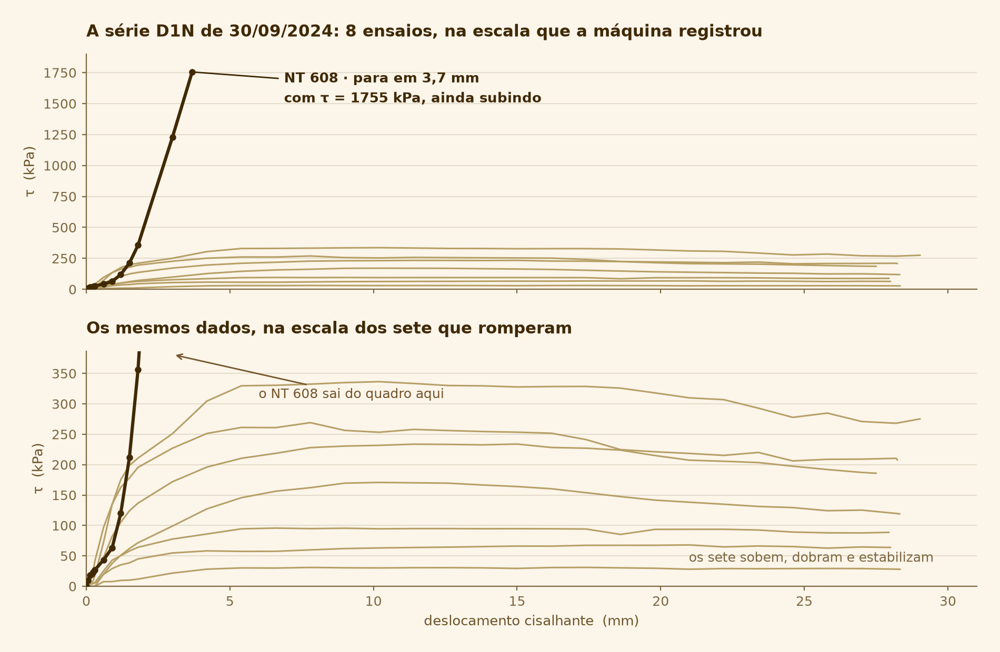

# Três ensaios registraram resistência altíssima sem nunca romper — e a conferência manual não teria como perceber

_12 de setembro de 2026_

## A frase

> O NT 608 marca **τ = 1.755 kPa sob σ = 160 kPa** — onze vezes a tensão normal. A leitura é
> real; resistência do solo não é. O ensaio parou aos 3,7 mm com a curva ainda acelerando,
> sem nenhum pico. **O processamento manual lê o máximo da coluna de τ e importa esse número
> como se fosse a resistência.** O sistema automatizado compara a forma da curva e o reprova.



## O que aconteceu

Cada ensaio de cisalhamento direto precisa ser reduzido a **um** valor de τ, que vira a
coordenada vertical de um ponto da envoltória. O jeito óbvio de obter esse valor é pegar o
máximo da coluna de tensão cisalhante — é o que uma planilha faz.

Isso só funciona se o ensaio tiver rompido. Num ensaio interrompido antes da ruptura, o
máximo não é a resistência: é apenas onde a máquina estava quando pararam. E ele entra na
regressão com a mesma autoridade dos pontos bons.

Procurando por esse caso nos 914 ensaios utilizáveis do acervo, apareceram três em que a
curva não só deixa de romper — ela **acelera** até o último ponto registrado.

## A evidência

### O filtro, em três etapas

| Critério | Ensaios |
| --- | ---: |
| Etapa de cisalhamento utilizável | 914 |
| Pararam antes de 5 mm de deslocamento | 13 |
| τ de pico **no último ponto** | 421 |
| Os dois critérios **juntos** — não romperam | 9 |
| Destes, com o trecho final acelerando | **3** |

**Por que os dois critérios juntos.** "Pico no último ponto" sozinho pega **421 dos 914** —
quase metade do acervo. Isso não é defeito: muito solo endurece até o fim do curso sem pico
definido, e a curva termina no seu valor mais alto porque o ensaio acabou, não porque deu
errado. Só combinado com o deslocamento curto o critério vira útil: sobram 9.

### Os três

| Ensaio | σ | τ final | Deslocamento | Pontos | Rigidez final ÷ mediana |
| --- | ---: | ---: | ---: | ---: | ---: |
| NT 268 `B2-1D-400D` | 399 kPa | 794 kPa | 3,3 mm | 13 | 41,0× |
| NT 608 `D1N16` | 160 kPa | 1.755 kPa | 3,7 mm | 13 | 5,0× |
| NT 625 `D7W4` | 400 kPa | 1.457 kPa | 3,8 mm | 13 | 3,8× |

Um ensaio normal do acervo percorre de 15 a 28 mm. Os três pararam entre 3,3 e 3,8 mm, e os
três gravaram **exatamente 13 pontos**.

### O NT 608, ponto a ponto

A etapa de cisalhamento inteira, do sétimo ponto em diante:

| Deslocamento | 0,60 | 0,90 | 1,20 | 1,50 | 1,80 | 3,00 | 3,69 mm |
| --- | ---: | ---: | ---: | ---: | ---: | ---: | ---: |
| τ | 43 | 63 | 120 | 212 | 356 | 1.229 | **1.755** kPa |
| Carga horizontal | 12 | 18 | 34 | 60 | 101 | 343 | **486** kgf |
| Desloc. normal | +0,12 | +0,19 | +0,22 | +0,22 | +0,22 | −0,53 | **−0,96** mm |

Três coisas acontecem ao mesmo tempo nos dois últimos pontos: **τ quase quintuplica**, a
**carga horizontal chega a 486 kgf**, e o **deslocamento normal inverte de sinal**.

Para dimensionar os 486 kgf, a carga horizontal máxima dos outros sete ensaios da mesma
série, no mesmo dia:

| σ (kPa) | 22 | 80 | 120 | **160** | 200 | 300 | 400 | 500 |
| --- | ---: | ---: | ---: | ---: | ---: | ---: | ---: | ---: |
| Carga horizontal máx. (kgf) | 8 | 16 | 26 | **486** | 44 | 60 | 71 | 90 |

O ensaio a 160 kPa pede **5,4 vezes mais carga** que o de 500 kPa, que é o mais carregado da
série.

### A interpretação

Carga que cresce sem limite enquanto o corpo de prova é levantado é o que se espera quando
**a caixa bipartida não está livre** — parafusos de travamento não retirados, fim de curso
alcançado, ou uma inclusão rígida no plano de ruptura. Nessa leitura, a máquina mediu a
reação do próprio equipamento, não a resistência do solo.

**Isto é dedução a partir dos números, não relato de quem estava na sala.** O que os
arquivos garantem é que a curva não rompeu, que a carga disparou e que o deslocamento normal
inverteu — os três juntos, nos mesmos dois pontos finais. A causa física não está gravada em
lugar nenhum, e nenhum arquivo diz por que o ensaio foi interrompido.

Vale notar o que a inversão do deslocamento normal **não** prova sozinha: 400 dos 914 ensaios
do acervo terminam com deslocamento normal negativo, o que é dilatância, comportamento normal
de solo denso. O que chama atenção aqui é a inversão acontecer junto com a carga atípica.

## Como conferir

**1. Refazer o filtro inteiro.**

```
uv run python scripts/ensaios_nao_rompidos.py
```

Percorre os 914 ensaios, reduz cada etapa de cisalhamento a um punhado de medidas e aplica
os dois critérios. Leva cerca de 9 segundos. Deve imprimir 13, 421, 9 e 3, seguidos da
tabela dos três ensaios.

**2. Abrir um ensaio específico.**

```
uv run python scripts/ensaios_nao_rompidos.py --detalhe 608
```

Imprime as medidas de um ensaio só: pontos, σ, τ de pico, τ final, se o pico está no último
ponto, deslocamento final, deslocamento normal, razão de rigidez e carga horizontal máxima.
Troque `608` por `268` ou `625` para os outros dois, ou por qualquer NT do acervo.

**3. Regenerar a figura.**

```
uv run python scripts/figura_travamento.py
```

Desenha a série D1N de 30/09/2024 inteira, em dois painéis com a mesma escala horizontal e
escalas verticais diferentes — a da máquina e a dos sete ensaios que romperam. Duas escalas
verticais no mesmo gráfico seriam engano; em painéis separados e rotulados, é comparação.

## Por que isso importa

**É o argumento central do trabalho.** O sistema não está automatizando o que já se fazia à
mão — ele está fazendo uma verificação que o método manual não comporta. Uma planilha lê o
máximo de uma coluna; ela não tem como saber que aquela curva nunca rompeu. Os três ensaios
acima sobreviveriam a uma conferência manual desatenta e entrariam na envoltória.

**O estrago seria invisível.** Na série D1N, o ponto de 160 kPa deveria valer cerca de 133
kPa, interpolando entre os vizinhos de 120 (95,7) e 200 kPa (170,8). Entrar com 1.755 no
lugar de 133 levanta a reta inteira e infla a coesão de um solo que não a tem. E o gráfico
final continuaria com cara de gráfico.

**Vira seção de métodos.** "Foram descartados N ensaios que não atingiram a ruptura, segundo
o critério X" é uma frase que um artigo precisa ter, e que só se escreve se o critério
existir e for reproduzível.

## O que eu decidi

**Separar descarte de sinalização.** Não romper (pico no último ponto **e** deslocamento
abaixo de 5 mm) **descarta** o ensaio da envoltória. Rigidez final acima de 3× a mediana
**sinaliza** para conferência humana, sem descartar.

A alternativa descartada era descartar também pela rigidez. Foi rejeitada porque a rigidez
alta é indício forte, não prova: a causa física não está gravada, e o sistema estaria tomando
sozinho uma decisão que é do pesquisador. Sinalizar preserva a decisão e ainda assim impede
que o ensaio passe despercebido.

A segunda alternativa descartada era usar a **magnitude** de τ como critério — reprovar o que
tiver τ muito acima de σ. Por que isso não funciona está no registro
[τ alto não é critério](2026-09-12-forma-da-curva.md).

## Ligações

- **Critérios e a tabela dos três:** `docs/arquitetura/formato-bruto.md` §5.2 e §5.4.
- **O script que aplica os critérios:** `scripts/ensaios_nao_rompidos.py`.
- **O registro vizinho, sobre por que a magnitude de τ não serve de critério:**
  [2026-09-12-forma-da-curva.md](2026-09-12-forma-da-curva.md).
- **A triagem que produziu os 914 de onde este filtro parte:**
  [2026-09-12-triagem-do-acervo.md](2026-09-12-triagem-do-acervo.md).

## O que ficou em aberto

**O ponto de 160 kPa da série D1N pode não estar perdido.** No dia seguinte, 01/10/2024, há
três ensaios a 160 kPa com o mesmo identificador `D1N16`: o NT 616 chegou a 157,0 kPa em
27,9 mm, o NT 618 a 121,6 kPa em 28,0 mm, e o NT 617 parou em 1,9 mm com 83,1 kPa. Os dois
primeiros romperam normalmente, e os dois cercam o valor esperado de ~133 kPa.

Se eles podem ou não substituir o NT 608 na mesma envoltória depende da regra de agrupamento
— uma série pode atravessar dois dias? É a **Q1** do `perguntas-orientador.md`, e sem essa
resposta não dá para dizer se a série vai à regressão com 7 ou com 8 pontos.

**A causa física dos três travamentos não está no dado.** Confirmar com quem operou as
máquinas se há registro de ensaio interrompido nessas três datas, e por quê, transformaria
três deduções em três fatos. Não está na lista de perguntas ao orientador.
