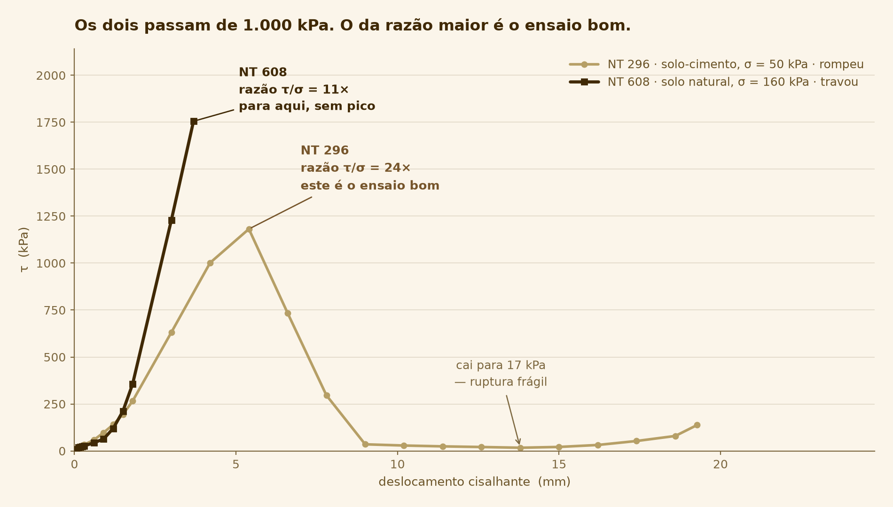

# O ensaio com a maior razão τ/σ do acervo é um dos bons — a magnitude não separa nada

_12 de setembro de 2026_

## A frase

> O filtro intuitivo para achar ensaio ruim é "τ alto demais para essa tensão normal".
> Ele descartaria **211 ensaios do acervo para pegar 3**. O ensaio de maior razão τ/σ que
> existe — 24 vezes — é um ensaio perfeitamente bom. **O que separa o bom do travado é a
> forma da curva, não o tamanho de τ.**



## O que aconteceu

Depois de encontrar três ensaios travados (registro
[ensaios travados](2026-09-12-ensaios-travados.md)), a pergunta natural é se dava para
achá-los de um jeito mais simples. O NT 608 marca τ = 1.755 kPa sob σ = 160 kPa. Pela
envoltória, τ = c + σ·tan φ, uma razão τ/σ de 11 vezes implicaria um ângulo de atrito
impossível para solo. Parece um filtro óbvio: reprovar o que tiver τ muito acima de σ.

Aplicado ao acervo, o filtro reprova 211 ensaios. Olhando quem são, ele se desfaz.

## A evidência

### O filtro por magnitude, medido

| | Ensaios |
| --- | ---: |
| Com etapa de cisalhamento utilizável | 913 |
| Com τ de pico acima de **1,2 × σ** | 211 |
| Destes, com pico **antes** do último ponto (romperam) | 106 |
| Destes, que também falham no critério de não-ruptura | **3** |

**Descartar 211 para pegar 3.** Os outros 208 são, na maioria, ensaios legítimos de material
cimentado. O acervo tem uma campanha inteira de solo-cimento, com o tempo de cura escrito no
próprio identificador — `B5-45D-50KPA` são 45 dias de cura sob 50 kPa. Material cimentado
tem coesão de centenas de kPa, e sob tensão normal baixa isso produz razões τ/σ altíssimas
sem nada de errado.

### As maiores razões do acervo

| NT | ID | σ | τ de pico | Razão | Caiu do pico |
| ---: | --- | ---: | ---: | ---: | ---: |
| 296 | `B5-45-50K` | 50 kPa | 1.182 kPa | **23,6×** | 88% |
| 281 | `B2-45D-50KPA` | 50 kPa | 1.147 kPa | 23,0× | 92% |
| 286 | `B2-30D-50KPA` | 51 kPa | 1.094 kPa | 21,7× | 90% |
| 273 | `B5-30D-50KPA` | 50 kPa | 1.078 kPa | 21,5× | 39% |
| 295 | `B5-45D-100` | 100 kPa | 1.637 kPa | 16,4× | **0%** |

A coluna "caiu do pico" é quanto τ desceu entre o pico e o último ponto. Um ensaio que rompe
tem esse número alto: ele quebra e a resistência despenca. Os quatro primeiros caem de 39% a
92%. O NT 295 cai 0% — nunca desceu, e é candidato a olhar com desconfiança.

**O NT 608, o ensaio travado, tem razão 11× — menor que todos estes.** Um filtro por
magnitude calibrado para pegá-lo levaria junto dezenas de ensaios bons; calibrado para poupar
os bons, deixaria o NT 608 passar.

### Os dois ensaios da figura, ponto a ponto

**NT 296** — solo-cimento, σ = 50 kPa, 15/02/2024:

```
τ (kPa)   12 → 19 → 28 → 58 → 97 → 195 → 631 → 1002 → 1182 → 734 → 296 → 35 → 29 → 24
                                                        pico    ruptura frágil   residual
```

Ele **sobe, quebra e cai** para 35 kPa — 3% do pico. É a curva de um solo cimentado que
rompe de forma frágil: a cimentação segura até ceder, e depois só sobra o atrito.

**NT 608** — solo natural, σ = 160 kPa, 30/09/2024:

```
τ (kPa)   43 → 63 → 120 → 212 → 356 → 1229 → 1755
                                              acaba aqui, no valor mais alto
```

Ele **só sobe**, cada vez mais rápido, e o arquivo termina. Não há pico, não há queda, não há
patamar residual. Nos dois últimos pontos a rigidez é 5 vezes a mediana do próprio ensaio.

### A interpretação

Uma curva de ensaio de solo tem uma forma esperada: sobe, atinge um máximo e ou estabiliza
num patamar residual, ou cai. Isso reflete o que acontece fisicamente — as partículas
resistem, o plano de ruptura se forma, e depois dele sobra o atrito residual.

Uma curva que acelera até o último ponto registrado não descreve solo rompendo. Descreve
carga crescente contra alguma coisa que não cedeu. **Essa leitura é dedução a partir da forma
do gráfico, não relato de quem operou a máquina.**

## Como conferir

**1. Refazer a contagem.**

```
uv run python scripts/razao_tau_sigma.py
```

Percorre os ensaios utilizáveis, calcula a razão τ/σ de cada um e separa os que romperam dos
que não. Deve imprimir 211, 106 e 105, seguidos da tabela das maiores razões. Leva cerca de
9 segundos.

**2. Ver a curva de um ensaio no terminal.**

```
uv run python scripts/razao_tau_sigma.py --detalhe 296
```

Imprime a etapa de cisalhamento ponto a ponto, com uma barra proporcional a τ. Dá para ver a
forma da curva sem abrir nenhum gráfico — sobe, pico, desaba. Compare com `--detalhe 608`,
que só sobe.

**3. Regenerar a figura.**

```
uv run python scripts/figura_forma_da_curva.py
```

Desenha os dois ensaios no mesmo par de eixos, sem truque de escala — é justamente o ponto
que os dois alcançam τ da mesma ordem de grandeza.

## Por que isso importa

**Justifica o critério escolhido.** No artigo, "por que vocês não usaram um limiar de τ?" é
uma pergunta previsível. A resposta tem número: o limiar descartaria 211 ensaios para
capturar 3, e deixaria passar o pior caso do acervo.

**Mostra o que a automação acrescenta.** Um limiar numérico qualquer pessoa aplica numa
planilha. Comparar a forma de uma curva com a forma esperada é o tipo de verificação que só
compensa fazer em código — e é onde está a contribuição do trabalho.

**Protege contra o erro oposto.** Um filtro por magnitude não só deixaria passar o ensaio
ruim: destruiria a campanha de solo-cimento inteira, que é material de pesquisa de outras
pessoas do grupo.

## O que eu decidi

**Nenhum critério de qualidade usa a magnitude de τ.** Todos olham a forma da curva: onde
está o pico, quanto a curva caiu depois dele, e qual a rigidez do trecho final.

A alternativa descartada era o limiar de razão τ/σ, com os números acima. Ela foi rejeitada
com dado, não por gosto.

Consequência assumida: os critérios ficam mais caros de explicar. "τ acima de 1,2σ" cabe numa
frase; "pico no último ponto e deslocamento abaixo de 5 mm" precisa de um parágrafo e de um
gráfico. É o preço de um critério que funciona.

## Ligações

- **Os três ensaios travados que motivaram esta pergunta:**
  [2026-09-12-ensaios-travados.md](2026-09-12-ensaios-travados.md).
- **Discussão original, com o NT 296:** `docs/arquitetura/formato-bruto.md` §5.3.
- **O script que conta os 211 e imprime as curvas:** `scripts/razao_tau_sigma.py`.

## O que ficou em aberto

**Um dos 914 "utilizáveis" não tem curva nenhuma.** O NT 923 (`CP1SATDMG3`, 25/11/2025) tem
31 leituras na etapa de cisalhamento e chega a 24,73 mm de deslocamento — um ensaio de curso
completo — mas **τ é zero em todos os pontos**. Ele passa no critério de triagem, que só
conta leituras, e por isso está entre os 914.

Este registro trabalha com 913 por causa disso. O critério de triagem precisa de uma quarta
condição — τ máximo maior que zero — e, quando ela entrar, o número da triagem muda de 914
para 913 e ganha registro próprio explicando a mudança. **O registro
[da triagem](2026-09-12-triagem-do-acervo.md) não será corrigido por cima.**

Falta descobrir se é defeito do arquivo, da célula de carga horizontal, ou um ensaio que
rodou sem o corpo de prova. Não está na lista de perguntas ao orientador.

**O NT 295 cai 0% do pico e tem razão 16×.** Nenhum critério atual o pega: ele para em
10,1 mm, acima do limiar de 5 mm do teste de não-ruptura — mas bem abaixo dos 15 a 28 mm de
um ensaio que corre até o fim. Pode ser um solo que endureceu até onde foi, o que é normal,
ou mais um travamento que o limiar de 5 mm não alcança. Merece olhar humano, e sugere que
esse limiar talvez esteja apertado demais.
