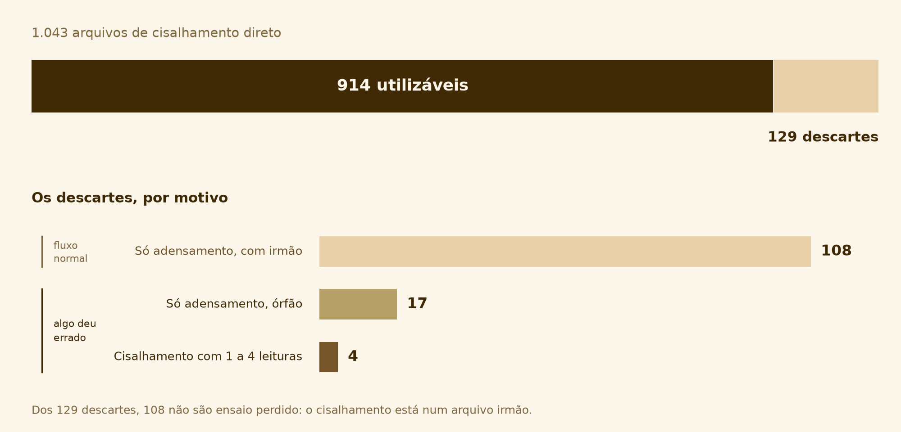

# O acervo tem 914 ensaios utilizáveis — e a maior parte do descarte não é ensaio perdido

_12 de setembro de 2026_

## A frase

> Dos 1.043 arquivos de cisalhamento direto do laboratório, **914 viram ponto de
> envoltória**. Dos 129 descartados, **108 são explicados por um arquivo irmão** que contém
> a etapa que falta, e apenas **21** indicam que alguma coisa deu errado.



## O que aconteceu

O acervo do laboratório do GeoFluxo tem 1.081 arquivos de ensaio, gravados automaticamente
pelas máquinas entre maio de 2023 e agosto de 2026. Destes, 1.043 são de cisalhamento
direto. Os identificadores de ensaio mostram que os arquivos vieram de mais de uma pessoa do
grupo.

Esta foi a primeira leitura do acervo inteiro **feita neste projeto**. Uma varredura
anterior, também deste projeto e ainda parcial, tinha descrito o resultado como
**"129 ensaios abortados"** — quase 13% do acervo.

Lendo os 1.043 arquivos um por um, essa descrição se mostrou errada. Os 129 existem, mas não
são 129 ensaios perdidos: são quatro situações diferentes, somadas como se fossem uma só.

## A evidência

| Situação | Arquivos | Significa falha? |
| --- | ---: | :---: |
| Etapa de cisalhamento com 5 ou mais leituras | **914** | — |
| Só adensamento, com irmão de cisalhamento | 108 | não |
| Só adensamento, órfão | 17 | sim |
| Cisalhamento com 1 a 4 leituras | 4 | sim |
| **Total** | **1.043** | |

### Os 108

**O que os arquivos mostram.** 125 arquivos não têm nenhuma leitura na etapa
`Cisalhamento`. Destes, 108 têm, no mesmo acervo, um outro arquivo com o **mesmo
`ID do ensaio` e a mesma data** — e esse outro arquivo tem a etapa de cisalhamento. Os 17
restantes não têm par nenhum.

**A interpretação, ainda não confirmada por ninguém do laboratório.** Um ensaio de
cisalhamento direto tem duas etapas: o corpo de prova é primeiro adensado sob a tensão
normal e depois cisalhado. A leitura mais provável dos 108 é que as duas etapas foram salvas
em arquivos separados, e que o arquivo "só de adensamento" é a primeira metade de um ensaio
cuja segunda metade está no arquivo irmão. Isso explica o padrão, mas é dedução a partir dos
dados — **não é relato de quem operou as máquinas.** Confirmar isso está na lista de
pendências, no fim deste registro.

### Os 4

**O que os arquivos mostram.** Quatro arquivos têm de 1 a 4 leituras na etapa de
cisalhamento. Duraram de 2 a 18 segundos e o deslocamento cisalhante não passou de 0,15 mm —
contra 15 a 28 mm de um ensaio que corre até o fim. Dois deles são de maio de 2023, as datas
mais antigas do acervo, e têm `ID do ensaio = MOVIMENTO`.

**A interpretação.** 0,15 mm de deslocamento não descreve o comportamento de um solo; não há
curva nenhuma em quatro pontos. O identificador `MOVIMENTO` e a data mais antiga do acervo
sugerem teste de equipamento — sugerem, não provam.

## Como conferir

Os números deste registro não precisam ser aceitos por confiança — eles são recalculados a
partir dos arquivos, por um script versionado, sempre que alguém rodar os comandos abaixo.

**1. Recalcular a tabela inteira.**

```
uv run python scripts/triagem_acervo.py
```

O script abre os 1.043 arquivos, um a um, e classifica cada um nas quatro situações. Leva
cerca de 8 segundos. A saída deve ser exatamente esta — se algum número estiver diferente
do que está na tabela acima, é porque o critério mudou desde 12/09/2026, e a diferença
precisa ser explicada:

```
Acervo de cisalhamento direto: 1043 arquivos

  Ensaio de cisalhamento utilizavel            914  ( 87.6%)
  So adensamento, com irmao de cisalhamento    108  ( 10.4%)
  So adensamento, orfao                         17  (  1.6%)
  Cisalhamento com 1 a 4 leituras                4  (  0.4%)
                                             -----
  total                                       1043

  Dos 129 descartes, 108 sao fluxo normal do laboratorio
  e apenas 21 indicam que alguma coisa deu errado.
```

**2. Ver quais arquivos caíram em cada situação.**

```
uv run python scripts/triagem_acervo.py --listar orfao
```

Em vez de só contar, lista os arquivos daquela situação com número do teste, data,
identificador e quantas leituras de cisalhamento cada um tem. É assim que se confere um
descarte individual, em vez de aceitar o total. Trocando `orfao` por `curto`, `com_irmao` ou
`utilizavel`, lista as outras três.

**3. Regenerar a figura deste registro.**

```
uv run python scripts/figura_triagem.py
```

A figura no topo da página não foi desenhada à mão: ela é gerada por este comando, que chama
a mesma função de triagem do comando 1. Por isso ela não tem como divergir do texto — se o
critério mudar, os dois mudam juntos. O arquivo é sobrescrito em
`docs/registros/figuras/triagem-do-acervo.png`.

## Por que isso importa

**Para o artigo.** A seção de métodos vai dizer "foram utilizados 914 ensaios". A pergunta
seguinte de qualquer leitor é "e os outros 129?". Com a tabela acima, a resposta é
verificável e mostra que o acervo é melhor do que o número bruto sugeria. Sem ela, a resposta
seria "o sistema descartou", que não é resposta.

**Para o projeto.** A descrição anterior sugeria um acervo com quase 13% de perda. Pelos
critérios aplicados aqui, a perda é de 2%. Isso muda a decisão de basear um ano de pesquisa
neste acervo.

**Para o desenho do sistema.** Esta foi a descoberta que determinou como o banco de dados
guarda a triagem. Um campo `valido` verdadeiro/falso registraria os 108 exatamente como
registraria os 17 — apagando a única distinção que importa. Por isso o modelo tem uma tabela
`ocorrencia` que guarda **o motivo**, não um sim/não.

## O que eu decidi

**Registrar o motivo de cada descarte, individualmente.** Quatro situações nomeadas, não um
booleano.

A alternativa descartada era o campo `valido` — mais simples de programar e de consultar. Foi
rejeitada porque perde a informação que responde ao leitor, e porque impediria o sistema de
distinguir "há um arquivo irmão com a etapa que falta" de "este ensaio se perdeu".

Consequência assumida: toda etapa a jusante precisa saber lidar com quatro valores em vez de
dois, e a interface tem que mostrar o motivo em algum lugar.

## Ligações

- **Definição dos quatro critérios de triagem:** `docs/arquitetura/formato-bruto.md` §5.1
  (as quatro situações) e §5.4 (o que o parser faz com cada uma).
- **A tabela `ocorrencia`, que guarda o motivo do descarte:**
  `docs/arquitetura/visao-geral.md` §6.
- **O commit que corrigiu a descrição errada:** `c0c5f8a` substituiu, no
  `formato-bruto.md`, o texto que chamava os 129 de "ensaios abortados" pela análise que deu
  origem a este registro.
- **O script que calcula 914, 108, 17 e 4:** `scripts/triagem_acervo.py`. Ele também é quem
  alimenta a figura, através de `scripts/figura_triagem.py`.

## O que ficou em aberto

**Os 914 não são o número final.** São os arquivos que *podem* virar ponto de envoltória.
Faltam dois filtros: o descarte de ensaios que não romperam (`formato-bruto.md` §5.4,
critério 3) e o agrupamento em séries, que depende de uma resposta do orientador. O número de
ensaios efetivamente usados será menor que 914.

**Duas interpretações precisam ser confirmadas no laboratório.** As duas estão na
**Q7** de `docs/arquitetura/perguntas-orientador.md`, com a evidência e a forma de perguntar
sem induzir a resposta:

- [ ] os 108 arquivos "só de adensamento" com irmão são mesmo ensaios salvos em duas partes?
- [ ] os arquivos com `ID do ensaio = MOVIMENTO` são teste de equipamento?

Enquanto não forem confirmadas, as duas ficam neste registro como dedução a partir dos dados
— o que são. Quando forem respondidas, a resposta vira um registro novo; este aqui não muda.
