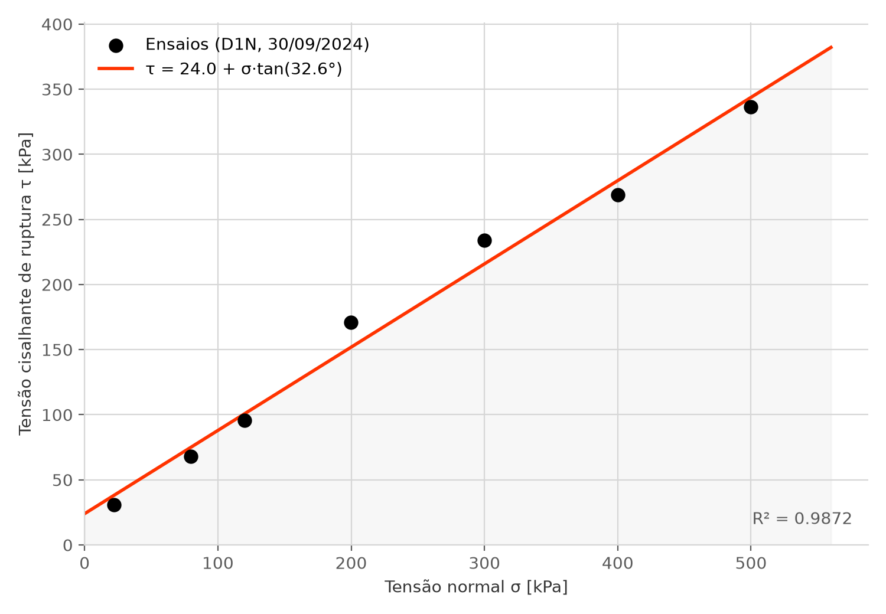

# A série D1N fecha uma envoltória com R² = 0,987 — mas só depois dos dois filtros

_29 de setembro de 2026_

## A frase

> Dos nove arquivos D1N gravados em 30/09/2024, **sete romperam**, e esses sete fecham sozinhos
> uma envoltória de Mohr-Coulomb: **c = 24,0 kPa, φ = 32,6°, R² = 0,987**. Com os mesmos
> arquivos, sem o filtro de não-ruptura, a regressão dá **φ = 5,7° e R² = 0,001**; com a tensão
> normal lida do identificador em vez da coluna, a coesão sai **negativa**. É a primeira
> envoltória do projeto calculada depois dos dois filtros — e o primeiro número que mostra o
> que cada um deles evita.



## O que aconteceu

Dois registros de 12/09 tratam de ensaios da mesma série, a D1N de 30/09/2024: o NT 608, que
não rompeu ([ensaios travados](2026-09-12-ensaios-travados.md)), e o NT 614, cujo identificador
anuncia 160 kPa quando a máquina mediu 22 ([o ID não é dado](2026-09-12-id-nao-e-dado.md)). Os
dois registros descrevem o que cada erro faria com a envoltória — "levanta a reta inteira",
"puxa a reta para baixo e reduz o φ" — mas nenhum dos dois calculou.

A apresentação ao orientador de 29/09 precisava de um gráfico para o resultado do slide de
abertura. A série D1N era a candidata natural: é a que os registros já conhecem ponto a ponto.
A envoltória foi calculada e, na mesma passada, recalculada com cada um dos erros que os
filtros evitam, para medir o efeito em vez de descrevê-lo.

O cálculo está em `scripts/apoio_apresentacao.py`, um script avulso que lê os `.csv` brutos
direto — o parser de produção ainda não existe em `src/geotec/parsers/`.

## A evidência

### Os nove arquivos D1N de 30/09/2024

σ é a mediana da tensão normal na etapa de cisalhamento; τ de pico é o máximo da tensão
cisalhante na mesma etapa — o valor que uma planilha também pegaria.

| NT | ID | σ medido | τ de pico | Desloc. final | Situação |
| ---: | --- | ---: | ---: | ---: | --- |
| 606 | `D1N8` | 79,8 kPa | 68,0 kPa | 28,00 mm | rompeu |
| 607 | `D1N12` | 119,8 kPa | 95,7 kPa | 27,95 mm | rompeu |
| 608 | `D1N16` | 159,7 kPa | 1.755,3 kPa | **3,69 mm** | **não rompeu** — pico no último ponto |
| 609 | `D1N50` | 500,0 kPa | 336,4 kPa | 29,03 mm | rompeu |
| 610 | `D1N4` | 399,9 kPa | 269,1 kPa | 28,24 mm | rompeu |
| 611 | `D1N3` | 299,9 kPa | 233,9 kPa | 27,50 mm | rompeu |
| 612 | `D1N2` | — | — | — | só adensamento; o NT 613, mesmo ID, tem o cisalhamento |
| 613 | `D1N2` | 199,8 kPa | 170,8 kPa | 28,32 mm | rompeu |
| 614 | `D1N16` | **22,2 kPa** | 31,0 kPa | 28,34 mm | rompeu — o ID sugere 160 kPa |

Os sete que romperam têm o pico antes do último ponto e percorreram de 27,5 a 29,0 mm. Ficam
fora da envoltória o NT 608, pelo critério de não-ruptura, e o NT 612, que não tem etapa de
cisalhamento — é um dos 108 casos "só adensamento, com irmão" da
[triagem](2026-09-12-triagem-do-acervo.md).

### A envoltória dos sete

Regressão linear de τ de pico sobre σ medido, τ = c + σ · tan φ:

| c | φ | R² | Pontos |
| ---: | ---: | ---: | ---: |
| **24,0 kPa** | **32,6°** | **0,987** | 7 |

### Quanto cada escolha muda o resultado

| Variante | Pontos | c | φ | R² |
| --- | ---: | ---: | ---: | ---: |
| **Correta:** os 7 que romperam, σ medido | 7 | 24,0 kPa | 32,6° | 0,987 |
| Sem filtro de não-ruptura: + NT 608 com o máximo de τ | 8 | 347,8 kPa | 5,7° | 0,001 |
| σ do NT 614 lido do ID (160 kPa em vez de 22,2) | 7 | −0,9 kPa | 34,5° | 0,889 |
| Série de dois dias: + NT 616 e NT 618, de 01/10/2024 | 9 | 28,5 kPa | 32,3° | 0,976 |

Os dois pontos do dia seguinte são NT 616 (σ = 159,8 kPa, τ = 157,0 kPa) e NT 618
(σ = 159,8 kPa, τ = 121,6 kPa). Os outros dois arquivos `D1N16` de 01/10 ficam fora de
qualquer variante: o NT 615 só tem adensamento e o NT 617 parou em 1,9 mm com o pico no
último ponto.

### A interpretação

**Sem o filtro, um ponto só destrói a envoltória.** Os 1.755 kPa do NT 608 são mais de cinco
vezes o maior τ dos outros sete. A reta passa a tentar explicar esse ponto, fica quase
horizontal e alta — c de 348 kPa, φ de 5,7° — e o R² cai para zero. O registro de 12/09 dizia
que o ponto "levanta a reta inteira e infla a coesão"; o cálculo confirma, e mostra que o
efeito é maior que o descrito: não sobra envoltória.

**Com o σ do nome, a previsão do registro de 12/09 acerta metade.** O registro dizia que o
NT 614 com σ = 160 kPa "puxa a reta para baixo e reduz o φ calculado". A reta de fato desce
perto da origem — a coesão cai de 24,0 para −0,9 kPa, um valor sem sentido físico —, mas o φ
**sobe**, de 32,6° para 34,5°. Leitura provável, **dedução a partir dos números**: o ponto de
22 kPa é o único abaixo de 50 kPa e ancora a reta perto da origem; levado para 160 kPa com o
mesmo τ baixo, a reta perde essa âncora e gira para ficar mais inclinada. O registro de 12/09
fica como está; a correção é esta.

**A pergunta Q1 pesa pouco nesta série.** Somar os dois ensaios de 160 kPa do dia seguinte
muda φ em 0,3° e c em 4,5 kPa. Isso vale para esta série — não dá para dizer, só com ela,
quanto a regra de agrupamento pesa nas outras.

**O φ fica logo abaixo da faixa da abertura.** A abertura da reunião cita φ entre 33° e 41°
([perguntas ao orientador](../arquitetura/perguntas-orientador.md)). Esta série dá 32,6°. A
faixa foi calculada antes do filtro de não-ruptura e sem separar a campanha cimentada
(`formato-bruto.md` §6); não é contradição, mas é mais um motivo para recontar a faixa depois
dos filtros.

## Como conferir

**1. Recalcular as quatro variantes.**

```
uv run python scripts/apoio_apresentacao.py variantes
```

Lê os `.csv` brutos da série, calcula as quatro regressões e imprime a tabela acima, seguida
dos pontos do NT 608, NT 616 e NT 618. Deve imprimir, para a variante correta,
`7  24.0  32.6  0.9872`.

**2. Regenerar a figura e ver os sete pontos.**

```
uv run python scripts/apoio_apresentacao.py envoltoria
```

Desenha `docs/registros/figuras/envoltoria-d1n.png` na paleta do `CLAUDE.md` e imprime c, φ,
R² e o par (σ, τ) de cada um dos sete ensaios.

**3. Conferir um arquivo à mão.** Abrir, por exemplo, `dados/Ensaios-270/Cisalhamento/2024-09-30
20-19-48 - NT 614 - DS - ID D1N16.csv`, filtrar a coluna `Etapa` por `Cisalhamento` e ler a
coluna `Tensao Normal [kPa]` (≈ 22) e o máximo de `Tensao Cisalhante [kPa]` (31,0).

## Por que importa

**É o primeiro resultado geotécnico que passou pelos filtros.** As 51 envoltórias da abertura
são uma estimativa superior, calculada antes deles. Esta é a primeira com c e φ que o projeto
pode defender ponto a ponto.

**Transforma dois argumentos em números.** "O sistema faz uma verificação que a planilha não
comporta" deixa de ser afirmação: sem o filtro, o R² vai de 0,987 para 0,001. "σ vem da coluna,
nunca do nome" também: pelo nome, a coesão fica negativa. Os dois números servem para a seção de
métodos do artigo e para responder "que diferença isso faz?".

**Dá material para a Q1.** A pergunta sobre agrupamento deixa de ser abstrata: nesta série,
atravessar o dia muda o φ em 0,3°.

## O que eu decidi

**A envoltória da série D1N de 30/09/2024 tem os sete ensaios que romperam, com σ medido.**
É o que o script calcula e o que a apresentação de 29/09 mostra (slide 11).

A alternativa descartada, por enquanto, era incluir o NT 616 e o NT 618, do dia seguinte. Os
números mostram que o efeito é pequeno, mas incluir é decidir a Q1 sem o orientador — e a regra
de agrupamento vale para o acervo inteiro, não só para esta série. Fica de fora até a resposta.

A outra descartada era apresentar a envoltória só com o gráfico dos sete pontos. Foi rejeitada
porque o gráfico sozinho não mostra por que ele merece confiança; as variantes mostram.

## Ligações

- **O ensaio que não rompeu (NT 608) e o critério que o descarta:**
  [2026-09-12-ensaios-travados.md](2026-09-12-ensaios-travados.md).
- **O identificador que anuncia 160 kPa (NT 614):**
  [2026-09-12-id-nao-e-dado.md](2026-09-12-id-nao-e-dado.md) — a previsão sobre o φ é corrigida
  aqui.
- **O arquivo só de adensamento (NT 612):**
  [2026-09-12-triagem-do-acervo.md](2026-09-12-triagem-do-acervo.md).
- **A regra de agrupamento e as 51 envoltórias:** `docs/arquitetura/formato-bruto.md` §6;
  `docs/arquitetura/perguntas-orientador.md` §Abertura e §Q1.
- **O script:** `scripts/apoio_apresentacao.py` (`variantes`, `envoltoria`).
- **Onde aparece:** `docs/apresentacoes/2026-09-29-reuniao-alinhamento.html`, slide 11.

## O que ficou em aberto

**A regressão não tem teste.** O `CLAUDE.md` pede que todo cálculo novo tenha teste com valor
de referência conferido à mão ou de norma. Este cálculo está num script de apoio, fora de
`src/geotec/nucleo/`. Quando a envoltória migrar para o núcleo, precisa do teste — e esta série,
com os sete pares (σ, τ) da tabela acima, é candidata a caso de referência.

**Falta o valor manual para comparar.** O `formato-bruto.md` §6 registra que o plano previa
comparar com c e φ processados à mão pelo laboratório. Se a série D1N tiver sido processada
manualmente, é a comparação mais direta possível.

**Uma série só.** Os efeitos medidos aqui — um ponto travado zera o R², um σ errado inverte a
coesão — são desta série. Recontar as 51 envoltórias depois dos dois filtros é o que diz se o
padrão se repete.

**As interpretações dependem do laboratório.** Que o NT 612 seja a primeira metade do ensaio
salvo no NT 613 continua dedução da triagem, na Q7. Por que o NT 608 não rompeu continua sem
registro de quem operou a máquina.
