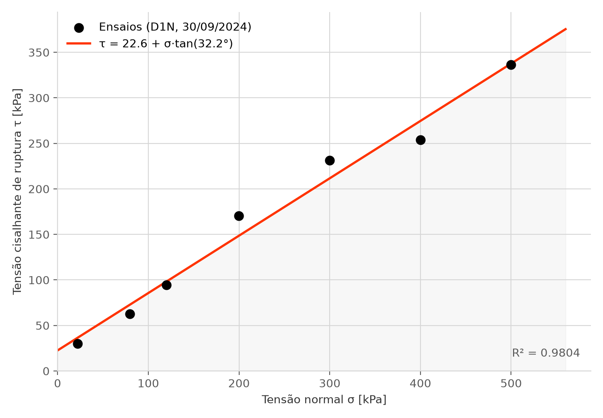

# O laboratório lê τ a 10 mm, não no máximo da curva — e a envoltória D1N passa a ser c = 22,6 kPa, φ = 32,2°

_29 de setembro de 2026_

## A frase

> O projeto vinha reduzindo cada ensaio ao **máximo de τ da curva inteira**. O laboratório não
> faz assim: lê τ **a 10 mm de deslocamento cisalhante**. Com o critério do laboratório, a
> envoltória da série D1N passa de c = 24,0 kPa, φ = 32,6°, R² = 0,987 para
> **c = 22,6 kPa, φ = 32,2°, R² = 0,980**. A mudança é pequena nesta série, mas os números
> apresentados daqui em diante são os de 10 mm.



## O que aconteceu

Cada ensaio de cisalhamento direto vira **um** par (σ, τ) na regressão da envoltória. Onde
ler esse τ na curva era a pergunta Q4 do [`perguntas-orientador.md`](../arquitetura/perguntas-orientador.md),
e o [`formato-bruto.md`](../arquitetura/formato-bruto.md) §3 a listava como pergunta em aberto.
Enquanto não havia resposta, o `scripts/apoio_apresentacao.py` usava o máximo de τ da etapa de
cisalhamento — "o valor que uma planilha também pegaria", nas palavras do
[registro da envoltória D1N](2026-09-29-envoltoria-d1n.md).

Na preparação da reunião de 30/09, o aluno informou que o **pico adotado pelo laboratório é o
τ com a amostra a 10 mm de deslocamento**. O critério foi trocado no script e a envoltória D1N
foi recalculada, com as mesmas quatro variantes do registro anterior.

A fonte do critério é essa informação do aluno sobre a prática do laboratório. Nenhum arquivo
bruto grava o critério, e este registro não tem a referência de norma ou procedimento escrito
do laboratório que o fixa.

## A evidência

### Não existe leitura exatamente em 10 mm

Nenhum dos 914 ensaios utilizáveis tem leitura em 10,00 mm. Dos 798 que chegam a 10 mm, **782
leem em 9,0 e 10,2 mm**, incluindo os sete da série D1N; os outros 16 têm leituras vizinhas
diferentes (de 8,98/10,18 a 9,82/10,68 mm). O τ a 10 mm é **interpolado linearmente** entre as
duas leituras vizinhas.

### 116 ensaios param antes de 10 mm

| Ensaios utilizáveis | 914 |
| --- | ---: |
| Chegam a 10 mm | 798 |
| Param antes de 10 mm | **116** |
| — destes, antes de 5 mm (o critério de não-ruptura já descarta) | 13 |
| — destes, entre 5 e 10 mm | **103** |

Pelo critério do laboratório, esses 116 não têm τ.

### Os sete ensaios, pelos dois critérios

σ é a mediana da tensão normal na etapa de cisalhamento, como no registro anterior.

| NT | σ | τ a 10 mm | τ máximo | onde ocorre o máximo |
| ---: | ---: | ---: | ---: | ---: |
| 614 | 22,2 kPa | 30,2 kPa | 31,0 kPa | 17,40 mm |
| 606 | 79,8 kPa | 62,9 kPa | 68,0 kPa | 21,00 mm |
| 607 | 119,8 kPa | 94,6 kPa | 95,7 kPa | 6,60 mm |
| 613 | 199,8 kPa | 170,6 kPa | 170,8 kPa | 10,20 mm |
| 611 | 299,9 kPa | 231,5 kPa | 233,9 kPa | 15,00 mm |
| 610 | 399,9 kPa | 253,8 kPa | 269,1 kPa | 7,80 mm |
| 609 | 500,0 kPa | 336,2 kPa | 336,4 kPa | 10,20 mm |

Em dois ensaios (NT 614 e NT 606) o máximo acontece **depois** dos 10 mm, num trecho da curva
que o critério do laboratório não lê. A maior diferença é no NT 610: 15,3 kPa.

### A envoltória e as variantes, recalculadas

| Variante | Pontos | c | φ | R² |
| --- | ---: | ---: | ---: | ---: |
| **Correta:** os 7 que romperam, σ medido, τ a 10 mm | 7 | 22,6 kPa | 32,2° | 0,980 |
| Sem filtro de não-ruptura: + NT 608 | 8 | 347,0 kPa | 5,1° | 0,001 |
| σ do NT 614 lido do ID (160 kPa em vez de 22,2) | 7 | −2,1 kPa | 34,2° | 0,884 |
| Série de dois dias: + NT 616 e NT 618, de 01/10/2024 | 9 | 26,8 kPa | 31,9° | 0,968 |

Pelo máximo da curva, as mesmas variantes davam 24,0 / 347,8 / −0,9 / 28,5 kPa de coesão
([registro anterior](2026-09-29-envoltoria-d1n.md)); o script refaz essa tabela também.

O NT 608 parou aos 3,69 mm e **não tem valor a 10 mm**. Na variante "sem filtro" ele entra com
o único número que o arquivo oferece, o máximo (1.755,3 kPa). Os pontos do dia seguinte a
10 mm são NT 616 (σ = 159,8 kPa, τ = 155,5 kPa) e NT 618 (σ = 159,8 kPa, τ = 115,6 kPa).

### A interpretação

**Nesta série, o critério pesa pouco.** A troca muda φ em 0,4° e c em 1,4 kPa. As conclusões
do registro anterior continuam de pé com os números novos: sem o filtro de não-ruptura o R²
vai a zero, e com o σ do nome a coesão fica negativa.

**Isso vale para esta série, não para o acervo.** As curvas da D1N são quase planas depois dos
10 mm (ver o slide 8 da apresentação de 30/09). Numa série em que as curvas continuem subindo
depois dos 10 mm, ou tenham um pico forte antes, a diferença entre os critérios pode ser maior.
**Dedução a partir da forma das curvas**, não medida.

**Ensaio que para antes de 10 mm não tem ponto.** Com o critério do laboratório, o NT 608 e os
outros travados (3,3 a 3,8 mm, [ensaios travados](2026-09-12-ensaios-travados.md)) não têm τ
a 10 mm. O critério de não-ruptura continua necessário: ele diz **por que** o ensaio sai, em
vez de o ensaio simplesmente faltar.

## Como conferir

**1. Recalcular as variantes com τ a 10 mm.**

```
uv run python scripts/apoio_apresentacao.py variantes
```

Deve imprimir, para a variante correta, `7  22.6  32.2  0.9804`.

**2. Refazer as contas pelo máximo, o critério anterior.**

```
uv run python scripts/apoio_apresentacao.py variantes-maximo
```

Deve imprimir os números do [registro anterior](2026-09-29-envoltoria-d1n.md), a começar por
`7  24.0  32.6  0.9872`.

**3. Ver os dois valores de cada ensaio.**

```
uv run python scripts/apoio_apresentacao.py curvas-d1n
```

Imprime a tabela dos sete ensaios acima: σ, τ a 10 mm, τ máximo, onde ele ocorre e o
deslocamento final.

**4. Contar o acervo.**

```
uv run python scripts/apoio_apresentacao.py acervo-10mm
```

Deve imprimir 914, 116 (13 e 103), 798 e as leituras vizinhas de 10 mm, começando por
`9.00 e 10.20 mm: 782`.

**5. Regenerar a figura.**

```
uv run python scripts/apoio_apresentacao.py envoltoria
```

Desenha `docs/registros/figuras/envoltoria-d1n-10mm.png`. A figura do registro anterior,
`envoltoria-d1n.png`, não é sobrescrita; `envoltoria-maximo` a refaz.

## Por que importa

**O número apresentado precisa ser o que o laboratório reconhece.** Se o sistema entregar c e
φ por um critério diferente do laboratório, a comparação com o processamento manual (prevista
no `formato-bruto.md` §6) começa com uma diferença que não é erro de ninguém.

**A frase "a planilha lê o máximo" não se sustenta mais.** Ela aparecia no registro dos
[ensaios travados](2026-09-12-ensaios-travados.md) e no slide 9 da apresentação de 30/09 como
descrição do processamento manual. O argumento do registro continua valendo: o NT 608 não
rompeu. Só a descrição de como o laboratório lê τ estava errada. O registro de 12/09 fica
como está; a correção é esta.

## O que eu decidi

**τ de cada ensaio é lido a 10 mm de deslocamento cisalhante, interpolado entre as leituras
vizinhas.** É o padrão do `scripts/apoio_apresentacao.py` e o que a apresentação de 30/09
mostra (slides 8 e 11).

A alternativa descartada era manter o máximo até o orientador responder a Q4. Foi rejeitada
porque o critério veio do próprio laboratório, e o máximo nunca foi escolhido: foi o jeito
mais simples de começar. O máximo continua disponível no script (`variantes-maximo`), para o
registro anterior seguir reproduzível.

A outra descartada era usar a leitura mais próxima de 10 mm (10,2 mm) em vez de interpolar.
Foi rejeitada porque 16 dos 798 ensaios que chegam a 10 mm leem em posições diferentes, e a
leitura mais próxima ficaria a distâncias diferentes de 10 mm em cada um. Não está confirmado
se o laboratório interpola ou lê a leitura de 10,2 mm; nos sete da D1N a diferença entre as
duas é pequena, mas não foi calculada.

## Ligações

- **A envoltória pelo máximo, que este registro atualiza:**
  [2026-09-29-envoltoria-d1n.md](2026-09-29-envoltoria-d1n.md).
- **A frase sobre a planilha e o critério de não-ruptura:**
  [2026-09-12-ensaios-travados.md](2026-09-12-ensaios-travados.md).
- **A pergunta que isto responde:** `docs/arquitetura/perguntas-orientador.md` §Q4;
  `docs/arquitetura/formato-bruto.md` §3.
- **O script:** `scripts/apoio_apresentacao.py` (`variantes`, `variantes-maximo`,
  `curvas-d1n`, `acervo-10mm`, `envoltoria`).
- **Onde aparece:** `docs/apresentacoes/2026-09-30-reuniao-alinhamento.html`, slides 8, 9 e 11.

## O que ficou em aberto

**A fonte escrita do critério.** Se o laboratório tiver o critério num procedimento, planilha
modelo ou norma interna, citar aqui transforma a informação do aluno em referência.

**Curva que continua subindo depois de 10 mm.** A ASTM D3080 prevê ler a um deslocamento
limite quando não há pico claro. Não está confirmado se o laboratório usa os 10 mm também
quando a curva tem pico claro antes disso (como no NT 610, pico de 269,1 kPa aos 7,8 mm). É o
que resta da Q4.

**Os 103 ensaios que param entre 5 e 10 mm.** O critério de não-ruptura descarta abaixo de
5 mm; estes passam por ele e não têm τ a 10 mm. É a maior pergunta que o critério abre: o
laboratório descarta esses ensaios, lê em outro ponto, ou eles nunca foram usados? Sem a
resposta, o número de ensaios que vira ponto de envoltória pode cair de 914 para perto de 800.

**A regressão continua sem teste**, como já dizia o registro anterior. A tabela dos sete pares
(σ, τ a 10 mm) acima é candidata a caso de referência quando o cálculo migrar para
`src/geotec/nucleo/`.
